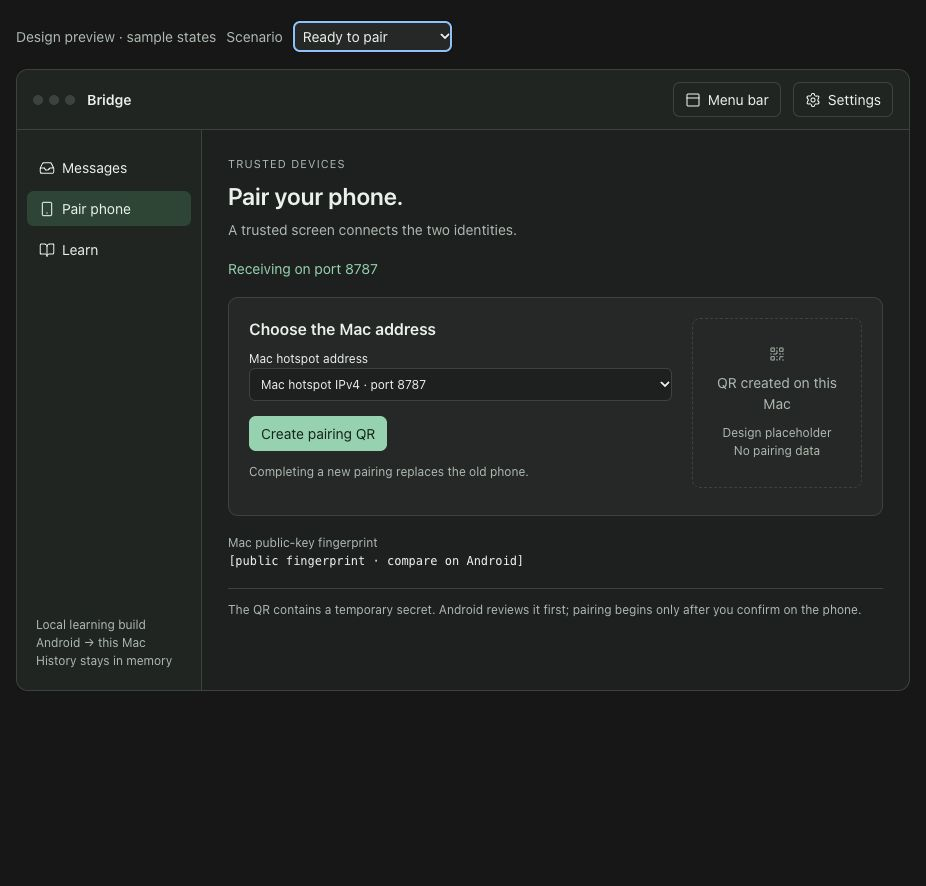

# Native Mac app: implementation and learning plan

Planning draft · 21 October 2026 · no app migration performed by this document.

Direction finalized in the learning discussion: build the native Mac recipient
first, preserving the current explicit QR trust step and one-way protocol.
Then design/test the Go relay for different networks with the same endpoint
trust principle. Account login, automatic device enrollment and cloud recovery
are deferred; they must not be added as silent substitutes for device approval.
Teach one actual pairing/request at a time before adding another subsystem.

Read sections 1–3 for the UI first. Sections 5–6 explain networking/encryption;
section 7 is the migration checklist and section 8 is the lesson sequence. This
is a reference to work through gradually, not homework to read in one sitting.



## 1. The first deliverable

Open a normal Mac application, pair the existing Android app by QR, send an
invented message and see the Mac verify/decrypt it. Close the window and keep
receiving through a menu-bar app. Quit the app and receiving stops.

This replaces the Python/web interface for the current one-way local lesson.
It does not start the Go relay, SMS, clipboard integration or group-membership
phases. Those remain separate steps in ../AGENTS.md. Android keeps Jetpack
Compose; the native Mac uses SwiftUI. Compose is our teaching comparison, not
a second UI framework inside the Mac app.

Minimum deployment target: macOS 14, matching the existing CryptoKit HPKE and
SwiftUI Observation usage. Verify the installed Xcode/SDK before implementation.
Use Apple's frameworks and a local shared Swift package; no third-party packages
are proposed. A local package simply lets two targets compile the same source.

## 2. What the app should look like

Use a restrained native Mac window, standard system typography, sidebar,
toolbar, normal buttons and system light/dark appearance. Keep the current
quiet teal identity as an accent. No custom title-bar machinery or UI framework.
Aim for a comfortable initial window around 1000 × 700, remaining usable around
720 × 520 with normal scrolling. Keyboard navigation, selectable text, VoiceOver
labels, visible focus and non-color-only status labels are part of the design.

Three sidebar destinations:

| Destination | Main content | Primary action |
|---|---|---|
| Messages | Latest verified messages, reception time and pinned sender; optional detail disclosure | Inspect a received message |
| Pair phone | Current peer/fingerprint, Mac address, QR state and pairing progress | Create a five-minute QR |
| Learn | Small lessons and the original readable/phone-only/paired comparison | Open one lesson or comparison |

Settings uses the native Settings window (Command-comma), not a fourth sidebar
destination. Initial settings: show short explanations and show the original
comparison lesson. Status/diagnostics shows the active address and fixed lab
port 8787, app version and memory-only history policy. No account/login screen.
No auto-copy, analytics, notifications permission or launch-at-login yet.

### Messages

- Fresh install: “Pair your Android phone to receive your first message” with a
  button leading to Pair phone. A saved peer with no current messages instead
  shows “Ready for a message from your paired phone.”
- Successful row: plaintext, time, “Paired sender verified” and an Inspect button.
  Opening details reveals ordered stages and the actual encrypted wire envelope.
- Stage labels: Received → Sender verified → Key unwrapped → Payload verified
  and decrypted → Replay state saved → Receipt signed. Record actual outcomes;
  do not animate invented progress when an operation completes atomically.
- A signed receipt means authenticated decryption and replay-state persistence;
  it does not promise that the human saw the message or that history was saved.
- Duplicates do not become new rows. Show a small duplicate count and explain why.
- Reject tampered requests without displaying untrusted plaintext. Local
  diagnostics may distinguish a bounded set of failure stages; no raw body,
  secret, exception dump or peer-controlled text in logs.
- Bound history to the last 40 observations as today. It remains memory-only.
  Do not render whole app state/private keys in a debugging inspector.

### Pair phone

1. Show saved pairing, if any, without implying the phone is online.
2. Show available private IPv4 addresses with interface names. Let Sparsh choose
   the hotspot interface; do not assume the first address is correct. Offer
   10.0.2.2 explicitly as an emulator-only choice. Do not embed 0.0.0.0 in a QR.
3. Create the QR inside Swift, using the existing bundle and Core Image generator.
   Show a countdown, fingerprint and an explanation that this QR includes a secret.
4. Android scans and reviews it. Scan alone does not pair. The phone confirms;
   the Mac verifies the handshake and updates this screen from a real event.
5. Clear the QR image and secret-bearing manual bundle after successful pairing,
   expiration, explicit replacement, receiver stop or app exit. Navigation within
   the app must not create new keys, reset expiry or create a second listener.
6. If already paired, say explicitly that completing another pairing replaces
   the existing phone. Merely creating a QR does not revoke the current peer.

Keep the trusted manual-bundle fallback in a disclosure. Do not automatically
copy the secret-bearing bundle to the pasteboard or add an export action.
An address change invalidates a pending QR. Existing identity trust does not
change with IP addresses: Android can edit its send address without trusting
keys fetched from that address.

### Learn and comparison

Show one short explanation at a time, with “What happens”, “Where in code” and
one small exercise. Explanation disclosures live beside Pair and Inspect too.
Default to one or two sentences; deeper detail is opt-in. Keep a useful app
visible rather than turning every screen into a textbook.

The original comparison accepts explicit sample text at /message and labels it
“Readable sample — sender unverified”. Phone-only AES ciphertext stays unreadable
on Mac. Paired plaintext appears only after verification/decryption. Keep these
three outcomes visibly distinct; do not count plaintext samples as E2EE successes.
The comparison remains a deliberate learning/debug feature.

### Menu bar and lifecycle

Build the normal window first. Add a small MenuBarExtra near the end, sharing
the same app-level model/service. It contains receiving status, Open Bridge,
Pair phone, Pause/Resume receiver, Settings and Quit. Do not show message bodies
or QR secrets in the menu-bar label.

“Receiving on port 8787” means the listener is ready, not that the phone is online.
“Paired” means keys are pinned, not that the network is reachable. Without a
heartbeat protocol we cannot honestly show “Phone connected”.

One window and one receiver per process. Closing the window leaves the app/menu
bar running. Command-Q stops listening, cancels outstanding reads and discards
ephemeral state. Reopening the window must not restart the listener or reload a
second mutable copy of Keychain state. Sleep stops progress; wake/network changes
refresh status without erasing keys or counters. No promise of offline delivery.

## 3. SwiftUI, explained through Compose

Both frameworks describe a UI from state: change state, then the framework
updates the parts that depend on it. A View/body is a description, not a place
to create sockets or generate permanent keys.

| Compose idea | SwiftUI counterpart here | Practical meaning |
|---|---|---|
| @Composable | struct conforming to View; var body: some View | A function-like description of a piece of UI |
| Column / Row / Box | VStack / HStack / ZStack | Vertical / horizontal / layered layout |
| Modifier chain | View modifiers such as .padding() | Decorate/layout a view; order can change the result |
| remember + mutableStateOf | @State | View-owned state; persists across body evaluations for that view identity |
| Hoisted value + onValueChange | @Binding | Child edits parent-owned state without owning another copy |
| ViewModel + observable state | @MainActor @Observable AppModel | Shared presentation state; conceptually similar, with different lifetime rules |
| CompositionLocal | @Environment | Pass dependencies/data through the view tree |
| LaunchedEffect | .task / .task(id:) | View-lifetime async work; cancellation matters; not the app-wide receiver owner |
| collectAsStateWithLifecycle | Observation plus explicit async event consumption | No exact one-line equivalent; choose the appropriate lifetime |
| Coroutine / suspend | Task / async-await | Wait without blocking the UI; async alone does not mean off-main work |
| Navigation state | Destination enum + List selection + NavigationSplitView | Selected destination determines the detail content |

Use @State at the App level to own one @Observable AppModel. Inject that same
reference into window/menu/settings. Use @Bindable where controls need bindings
to model properties. @AppStorage is only for harmless preferences, never keys,
pairing secrets, replay counters or message history.

NavigationSplitView supplies the sidebar/detail structure. Selecting Pair phone
sets a destination enum and changes the detail view. Inspect can open a sheet
for one observation. No third-party router, navigation graph generator or broad
MVVM framework. A tiny application delegate is acceptable if needed for reliable
Mac lifecycle/window reopening; do not add an AppKit wrapper library for that.

On Android, keep Compose screens driven by the existing hoisted LabState and
explicit user events into LabViewModel. Keep QR/network effects outside
composable rendering, and preserve state through rotation. Match the Mac's
plain-language Pair/Encrypt/Send/Inspect terms and verification labels if small
companion UI changes are needed. Do not port the Mac UI to Compose Multiplatform
or add a navigation/state framework just to make the two platforms look alike.

Receiving must continue independently of which screen is visible. A view's
.task may be cancelled when that view disappears; the application coordinator
owns the long-lived listener/event task, and stops it on explicit pause/quit.

## 4. Ownership: who does which job?

```text
App / lifetime owner
  ├─ AppModel (@MainActor, @Observable) → SwiftUI window / menu / settings
  ├─ LocalHTTPServer (Network framework; bounded connections)
  │    └─ EndpointService actor → existing protocol engine → Keychain
  └─ local typed events → AppModel → Messages / Pair / Learn
```

MainActor means UI-facing changes are serialized on the UI executor. Keychain
and crypto work do not run in SwiftUI body or occupy the UI executor. The
EndpointService actor owns the protocol engine and all mutable identity/replay
state. Do not pass its dictionaries, key objects or private state to views.
Pass typed Sendable input/results or Data across concurrency boundaries.

An actor protects mutable state, but it can be re-entered at an await. Keep
verify → deduplicate → persist → update committed state as one serialized
transaction with no suspension in the middle; publish UI events afterward.
Avoid “Task.detached everywhere” and one crypto service per window/connection.

Distinguish two result types: a WireReceipt for the phone and a LocalObservation
for the Mac UI. The networking layer must serialize only WireReceipt. This makes
accidentally returning decrypted text harder than handing around an untyped
dictionary containing both fields.

Proposed source layout in the eventual parent monorepo (not created yet):

```text
ClipSparshur/
  mac/
    BridgeMac.xcodeproj
    BridgeMac/
      App/BridgeMacApp.swift, AppModel.swift
      Views/RootView.swift, MessagesView.swift, PairPhoneView.swift, LearnView.swift
      Views/MessageInspector.swift, SettingsView.swift, StatusMenu.swift
      Networking/LocalHTTPServer.swift, HTTPRequestParser.swift
    BridgeCore/                         # local Swift package, zero remote packages
      Package.swift
      Sources/BridgeCore/
        PairingEndpoint.swift, PairedProtocol.swift, KeychainStore.swift
        EndpointService.swift, Models.swift
      Tests/BridgeCoreTests/
  SparshurAndroid/                       # current checkout stays in place
    tools/mac_endpoint/main.swift         # thin CLI adapter using the same core
    spec/paired-test-vectors.json         # existing shared interop fixture
```

File boundaries are proposed responsibilities, not a requirement to create a
class per file or an interface per operation. Start small; split as it helps the
lesson. Project files must follow the actual Xcode installation/signing setup.

## 5. Networking from zero: the local lesson

Our Mac app is a server here. “Server” describes a job, not a cloud computer:
it waits for requests. Android is a client: it initiates a connection.

```text
Phone message
  → UTF-8 bytes → encrypted/signed JSON envelope
  → HTTP POST to Mac-IP:8787/paired-message
  → TCP carries bytes across the hotspot network
  → Mac's NWListener accepts an NWConnection
  → bounded HTTP parser collects headers/body
  → protocol engine authenticates/decrypts and commits replay state
  ├─ local observation updates SwiftUI
  └─ HTTP 202 + signed receipt returns to Android
       → Android verifies Mac signature → reports decryption
```

- IP address: which network interface/device to reach. Port: which listening
  program on that device. Path: which operation inside that program.
- TCP: ordered byte delivery on a live connection, not complete “message packets”.
  A receive callback may contain half a header or several pieces together.
- HTTP: rules for request method/path, headers, body length and response status.
  JSON: a text container for the envelope. Base64: a way to put binary bytes in
  that text. Neither is encryption.
- NWListener/NWConnection supply transport, not a ready-made HTTP server.
  URLSession is normally a request-making client; it cannot replace the listener.
- The hotspot routes to a private address locally; mobile public IP/NAT is not
  used for this delivery. A hotspot/router may isolate clients. A private IP
  check alone does not prove same-network membership or authenticate a device.
- Changing networks can change the Mac's IP. Show the new address; do not change
  trusted keys. In-flight/unsent delivery is not automatically queued today.
- A timeout is ambiguous: Mac may have accepted the message before a response
  was lost. Retry the exact envelope, not a new encryption under its identity.
  An accepted duplicate gets a signed receipt without a second row. The strict
  high-water counter still rejects unknown older/reordered messages.
- Last seen is the time of an actual accepted event. A listening socket is not a
  persistent phone connection. Close each lab HTTP connection after its response.

### Native HTTP compatibility contract

Keep the Android-facing wire format and canonical signature bytes unchanged.

| Route | Native behavior |
|---|---|
| GET /health | Same service bridge-learning-observer and lab_version:1 for the existing Android check |
| POST /message | Preserve original sample validation, bounds and in-memory dedup |
| POST /pairing/complete | Same v2 handshake validation and acknowledgement |
| POST /paired-message | Same v2 checks and signed 202/new or 200/duplicate receipt |

The browser-only /api/events, /api/pairing/status and /api/pairing/new do NOT
become public app-management routes. SwiftUI calls local methods for pairing
generation/status/history. No HTTP endpoint exports the QR or decrypted history.

Keep the parser intentionally narrow and debug/local-only. Implement and test
one HTTP/1.1 request per connection, CRLF header framing, exact decimal
Content-Length, case-insensitive header names, application/json with optional
charset, at most 8 KiB headers, at most 32 KiB body, a five-second request
deadline and a small bounded concurrent connection count (initially 8).
Reject duplicate/ambiguous Content-Length, Transfer-Encoding/chunked requests,
pipelining, unsupported methods/routes, header folding, malformed UTF-8/JSON,
duplicate JSON keys (including escaped-equivalent keys), booleans masquerading
as numbers, excess nesting and unknown schema fields. Extra trailing body bytes
fail. Reject peer addresses outside the current private IPv4/loopback scope.
Reject unexpected browser Origin values rather than making the LAN API CORS-open.
Use bounded 4xx/5xx failures without reflecting payloads into responses/logs.

The existing Python layer performs duplicate-key/schema/HTTP validation that
must survive migration; JSONDecoder/JSONSerialization alone do not substitute
for every check. Stream handling and strict JSON ingestion are real work. If we
cannot confidently bound/test the required subset, stop that implementation
step and reconsider a maintained HTTP server dependency with an ADR rather than
silently widening the parser or calling this a general-purpose server.

### Platform setup

Use macOS 14-compatible NWListener/NWConnection rather than requiring the newer
macOS 26-only networking APIs. Keep networking outside views. Initially use a
normal sandboxed macOS target with Incoming Connections (Server) entitlement;
add outgoing access when an actual outbound feature needs it. Include a truthful
NSLocalNetworkUsageDescription and test local-network permission behavior on
the installed OS (macOS 15+ has local-network privacy). Firewall permission is
separate from app sandbox and local-network privacy. Handle denied access and
port conflicts explicitly; never suggest disabling the firewall globally.

Verify local signing, sandbox and existing Keychain item access in the FIRST
spike. Do not promise that the CLI's Keychain ACL automatically grants access to
the new app identity. See migration below. No Bonjour/multicast discovery is
needed: the QR carries an explicit endpoint.

## 6. The E2EE lesson, step by step

Keep spec/PAIRED_V2.md as the byte-level contract. Extract existing crypto code;
do not invent a different protocol while also migrating UI/networking.

### Pair once: establish who to trust

1. Mac loads/creates its own identity through Keychain. Its long-term signing
   key identifies receipts/handshake confirmations; its HPKE key receives keys.
2. Mac displays public keys, chosen endpoint, a fresh pairing ID, a temporary
   secret and five-minute expiry in its QR. The QR is a trusted out-of-band
   channel: the phone reads it from the intended Mac's screen.
3. Android scans, validates, shows the fingerprint and waits for Pair.
4. Android sends its public signing key plus an HMAC proof and signature over
   the complete transcript. The secret itself is not sent over HTTP.
5. Mac checks expiry/proof/signature and saves the paired sender. It returns its
   own proof/signature; Android verifies these before pinning Mac public keys.
6. The one-time secret is discarded. Re-pairing changes the epoch; valid old
   envelopes no longer belong to the active pairing.

HMAC proves possession of the temporary shared secret. Public-key signatures
prove possession of the corresponding signing private key. The fingerprint is
a public comparison label, not a password and not proof of network reachability.

### Send each message: hide, bind, authenticate

1. Android reserves a durable counter and makes a fresh random content key.
2. ChaCha20-Poly1305 encrypts UTF-8 text and detects tampering. AAD binds public
   version, pairing, sender/recipient, type, counter and message ID.
3. HPKE encrypts/wraps that content key for the pinned Mac public key. Only the
   intended Mac's private key can recover it. HPKE base mode alone does not prove
   the sender, so Android also signs the complete envelope with Ed25519.
4. Mac verifies sender/context, unwraps the key, verifies/decrypts the payload,
   rejects replay conflicts and saves replay state before disclosure/receipt.
5. Mac signs a receipt binding the specific message/digest/counter. Android
   verifies it using the already-pinned Mac signing key.

The original lab's AES key remains nonexportable inside Android Keystore and
is never the shared messaging key. Android's paired signing seed is SOFTWARE
material encrypted at rest by a separate Keystore key; its bytes are used in app
memory for signing. Mac's software Curve25519 keys are protected at rest in
Keychain and used in process memory. Do not claim these keys are permanently
hidden from their own application or hardware-backed Secure Enclave keys.

E2EE here is one-way paired payload protection across two endpoints, with a
human-review requirement. HTTP still exposes metadata and allows traffic
disruption. There is no forward secrecy against later compromise of the Mac's
long-term HPKE key, ratchet, durable inbox or multi-device membership yet.

### Later internet transport: different networking, same boundary

```text
Android ── TLS/WebSocket ── Go relay ── TLS/WebSocket ── Mac app
 encrypts                  opaque bytes                 decrypts
```

Both devices initiate outbound connections; a hotspot private address is no
longer the destination. TLS protects each client-to-relay connection. Payload
E2EE keeps content unreadable to the relay itself. These protect different
boundaries. Do not call TLS alone E2EE.

The parent plan names URLSessionWebSocketTask for Mac; retain that planned
choice for now. Apple's current networking guidance favors Network framework
for new WebSocket code; revisit in a future relay ADR in light of the deployment
target and teaching goals. No relay implementation or library choice is part
of this migration. Protobuf, durable at-least-once delivery, reconnect/backoff,
ordering windows, revocation/membership and reverse-direction encryption need
their own specs. Do not assume today's lab JSON is the final internet protocol.

## 7. Migration: keep a working checkpoint at every step

| Step | Change | Demonstration / completion gate |
|---|---|---|
| A. Platform spike | Create native SwiftUI target/local signing; verify sandbox, listener permissions and legacy Keychain access | Opens locally without paid membership for the basic target; one controlled own-item access; no key reset |
| B. Extract core | Move reusable Endpoint, protocol helpers and Keychain code to a local Swift package; keep CLI as adapter | Frozen shared vectors and existing Android→Python→Swift tests still pass |
| C. Window and state | Native sidebar, empty states, settings, app-owned state; previews use clearly marked samples only | Navigate without recreating service/keys; sample previews never enter live history |
| D. Native receiver | NWListener, bounded HTTP/parser/strict JSON ingestion, typed routing and responses | Partial/coalesced bytes, negative inputs, size/deadline limits; original Android /health and /message work |
| E. Pairing | Native QR and expiry UI calling the same extracted core | Existing Android scans/pairs; expiry/replacement/confirmation tested |
| F. Decrypt and inspect | Publish genuine local results to Messages and signed receipts to Android | Actual Android text verified/decrypted; tamper, duplicate, restart and receipt-forgery checks pass |
| G. Menu bar/lifecycle | Same service stays alive after window closes; explicit pause/quit | No duplicate listener; reopen works; sleep/wake and hotspot IP change exercised |
| H. Switch default | Update run guide and emulator harness to launch/test the native recipient | App works with Python stopped; no browser/subprocess needed; old lab retained for comparison |

The first implementation milestone is A→C, not all networking at once. Explain
and demonstrate each checkpoint before moving on, with a short code walkthrough
and a tiny owner exercise. The whole Mac deliverable is not complete until H.

### Preserve trust and rollback deliberately

- Keep the existing Keychain service/account and serialized state schema during
  extraction: com.sparsh.bridge.learning.v2 / identity-and-replay-state.
- Record the PUBLIC fingerprint/high-water facts, stop Python/its helper, then
  launch the native app. Both may write the same state; never run them together,
  even on different ports. Binding port 8787 prevents one accidental conflict,
  but is not a complete cross-process state lock.
- A newly signed/sandboxed app may need Keychain authorization or may not be able
  to access the legacy item's namespace. Test this before committing the app
  architecture. Preserve the old item; never silently manufacture a replacement,
  export private bytes through files, broaden access to all apps or reset counters.
- Preferred success: app uses the same item through supported Keychain access,
  same public fingerprint and preserved replay state. If platform constraints
  block that, document a deliberate fresh-pairing migration or a temporary helper
  checkpoint; make the owner-visible identity change explicit. A helper-dependent
  checkpoint is not the final native deliverable.
- Roll back by quitting native first, then starting the old receiver against
  compatible state. After any deliberate fresh identity/pairing, acknowledge that
  the old app/phone pairing may no longer be valid; no invisible rollback promise.
- Do not change existing key aliases, bundle wire fields, signature canonical
  strings, IDs, counters or test vectors just to simplify the UI port.

## 8. Learning sessions matched to implementation

Each session: one visible outcome, a small set of new ideas, relevant files and
one exercise. Roughly 30–60 minutes, adjusted to the questions—not a deadline.

| Session | Ideas | Small exercise |
|---|---|---|
| 1. Read a Swift view | let/var, struct, functions, optionals, closures, protocols; View/body and modifiers | Add a label and explain which property it reads |
| 2. Navigation/state | @State, @Binding, @Observable, @Environment, selection and view identity | Change sidebar selection; predict which view updates |
| 3. App lifetime | App/Scene/Window, menu bar versus window, dependency ownership | Close/reopen window; show why the receiver instance must stay the same |
| 4. QR and pairing | JSON→UTF-8→QR image; scanner reverses it; fingerprint/secret/public key | Find the exact moment scan becomes a network handshake |
| 5. Networking basics | Client/server, IP/port/path, TCP bytes, HTTP headers/body, response codes | Trace one POST; split its bytes and predict what the parser must wait for |
| 6. Async and isolation | async/await, Task/cancellation, MainActor, actors, Sendable, await reentrancy | Explain why a QR countdown must not recreate a listener and why crypto is off-main |
| 7. Crypto with concrete bytes | Random key, nonce, AAD, AEAD tag, HPKE wrap, Ed25519 signature | Match each envelope field to its job; alter a copy and explain rejection |
| 8. Storage/retries | Keychain vs memory, saved counters, replay cache, ambiguous timeout | Resend exact bytes; restart; explain why there is no second row |
| 9. End-to-end ownership | UI → transport → core → storage → event → UI; migration boundaries | Narrate one real message using file names, without memorizing algorithm internals |

Reference refreshers should be short and tied to the current file. Revisit
errors/throws, enums/pattern matching, Codable and value/reference semantics
where they first become useful. Do not front-load an entire Swift course.

## 9. Acceptance checklist

- Builds/runs locally with installed Xcode, target macOS 14+, no remote packages.
- Current Android debug app interoperates without a new pairing protocol.
- Paired path, readable comparison and phone-only AES path have truthful labels.
- QR generated entirely locally; secret absent from network management routes,
  logs and permanent preferences; expired/successful QR is removed.
- Sender authentication, payload verification and replay persistence precede
  plaintext disclosure; successful HTTP response contains signed receipt only.
- Core vectors/negative crypto tests; HTTP stream, schema/duplicate-key and size
  tests; restart replay and replacement pairing; persistence failure does not
  acknowledge success or expose plaintext.
- Real Android→native Mac integration, receipt verification, altered tags/signatures,
  duplicate retries, lost-receipt retry, app restart and same-fingerprint migration.
- Actual phone QR scan/hotspot and macOS network/Keychain denial exercised; emulator
  proof alone does not substitute. Test minimum OS separately if unavailable here.
- Window close/reopen, explicit pause/resume, quitting, address change and port
  conflict produce clear states; live UI contains only real observations.
- README, reading order, migration notes and ADR describe actual delivered behavior;
  code-review-graph refreshed after implementation. This plan itself needs no app
  build/test run because it does not modify runtime behavior.

## 10. Apple references for the implementation lessons

- [NavigationSplitView](https://developer.apple.com/documentation/swiftui/navigationsplitview): native sidebar/detail navigation.
- [Managing model data](https://developer.apple.com/documentation/swiftui/managing-model-data-in-your-app): Observation and UI updates; available on macOS 14+.
- [MenuBarExtra](https://developer.apple.com/documentation/swiftui/menubarextra): app access while its window is not active.
- [NWListener](https://developer.apple.com/documentation/network/nwlistener): incoming connections, readiness and cancellation.
- [Choosing the right networking API](https://developer.apple.com/documentation/technotes/tn3151-choosing-the-right-networking-api): client/server and HTTP/WebSocket choices.
- [Local network privacy](https://developer.apple.com/documentation/technotes/tn3179-understanding-local-network-privacy): permission behavior and troubleshooting.
- [Configuring Keychain sharing](https://developer.apple.com/documentation/xcode/configuring-keychain-sharing): access-group constraints; do not assume a legacy CLI item automatically migrates to a sandboxed app.

Platform links were consulted while planning. The architecture above is our
proposal; it is not an Apple sample or an assertion that untested migration
details already work.
