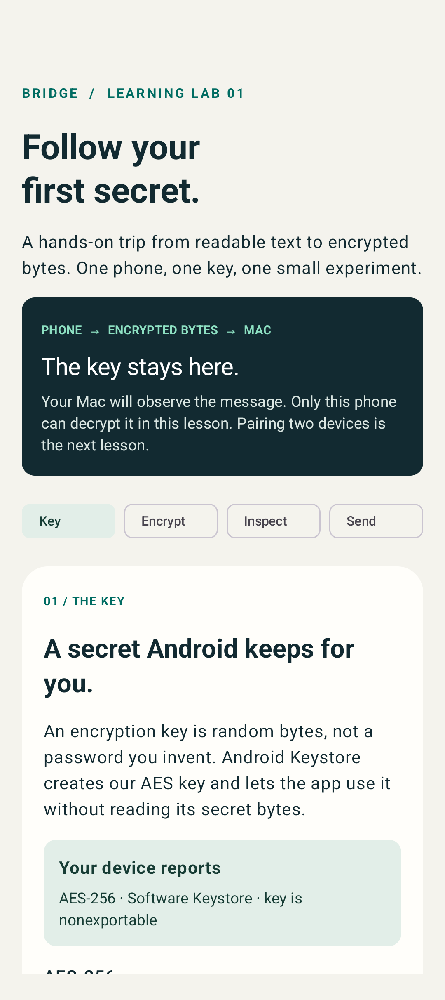
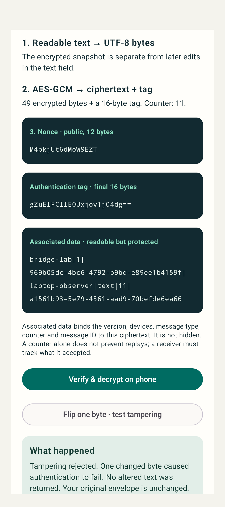
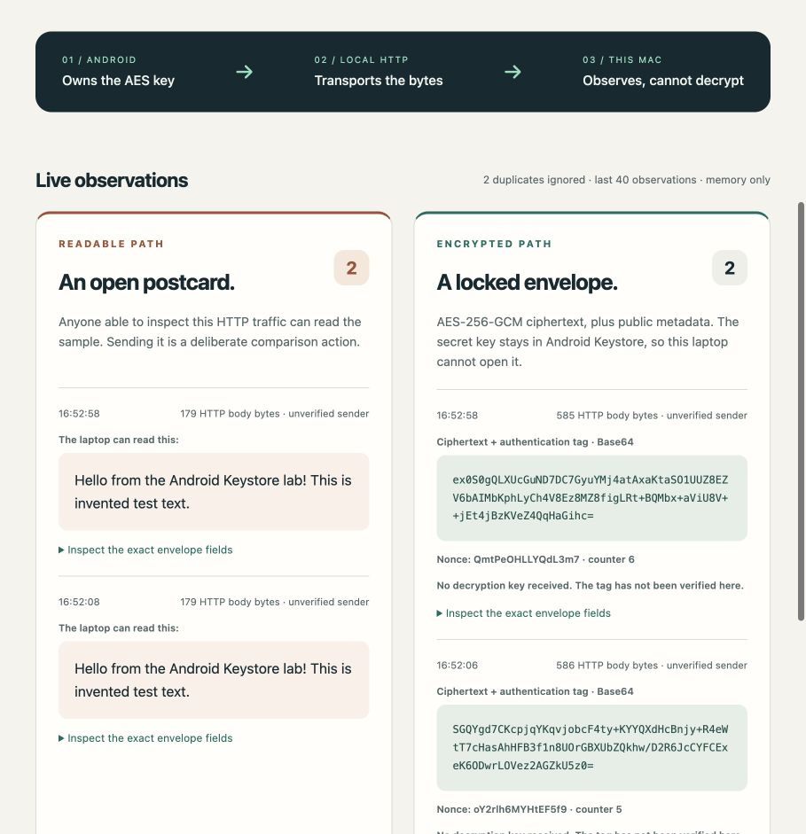

# Verification — 20 October 2026

Completed on this Mac using Android Studio JBR 25, Gradle 9.6.0, the installed
Android SDK 37, and Pixel_10a emulator running Android 17 / API 37.

## Passing checks

- Debug APK and unsigned release APK build successfully.
- JVM tests: **6 passed** (5 crypto/protocol/destination tests + 1 starter test).
  Includes NIST AES-256-GCM known-answer output, independent Python↔JVM lab
  vector, changed ciphertext/tag/key/nonce/metadata rejection, local destinations.
- Android instrumentation: **7 passed** (6 lab tests + 1 starter test).
  Includes actual AndroidKeyStore round trip, counter/key reuse across wrapper
  instances, nonexportable key bytes, random nonce differences, authenticated
  metadata rejection, Unicode, input bounds and ciphertext-only wire fields.
- Compose interaction test: encrypt → verify/decrypt → alter one byte → reject.
  Included in the seven Android tests. Screenshots captured through the test
  and visually inspected; all four lesson tabs now fit the tested phone width.
- Actual Android→Mac integration: health request, encrypted envelope, duplicate
  envelope and readable comparison all worked through emulator address
  10.0.2.2:8787. Mac dashboard displayed genuine Android observations in its two
  columns. The observer never received the Keystore key or decrypted the message.
- Python receiver tests: **9 passed**, including live HTTP routes, strict schema,
  500 deterministic malformed-envelope mutations, Unicode/size limits,
  concurrent duplicate suppression, conflicting ID rejection, bounded state,
  cross-origin/Host checks and shared envelope vector.
- ktlint 1.7.1: passed for app Kotlin sources and app build script.
- Receiver JavaScript syntax and Android XML parsing: passed.
- Android lint: **0 errors, 15 warnings**. Remaining warnings concern dependency
  update suggestions, starter unused resources/redundant label, and the KTX edit
  suggestion. The explicit SharedPreferences commit is intentional: encryption
  must check its Boolean result before reserving a counter successfully.
- Merged manifests inspected: debug cleartext true, release cleartext false;
  app backup false in both. Network code also checks BuildConfig.DEBUG.
- code-review-graph 2.3.9 installed locally and built: 24 source files, 140 nodes.
  Used file-summary and caller queries during review. No cloud embeddings or
  global MCP configuration changes. Git-based change analysis remains unavailable
  because this starter directory is not a Git repository.

The starter's Espresso 3.5.1 could not drive Android 17 because it reflected a
removed InputManager method. Updating existing test dependencies to Espresso
3.7.0 / AndroidX JUnit extension 1.3.0 fixed that failure. No Android runtime
dependencies were added.

## Commands

    python3 -m unittest discover -s tools -p 'test_*.py' -v
    ./gradlew :app:assembleDebug :app:assembleRelease :app:testDebugUnitTest :app:lintDebug :app:assembleDebugAndroidTest
    ./gradlew :app:connectedDebugAndroidTest -Pandroid.testInstrumentationRunnerArguments.receiverHost=10.0.2.2

The final instrumented suite was also run directly with adb after installing the
two debug APKs, leaving the app installed and retaining the test's invented-text
screenshots for documentation. It reported OK (7 tests).

## Still needs the physical phone

No real phone was attached. Hotspot routing, the phone's actual Keystore hardware
level, OEM behavior, and permission prompts need a run on the owner's phone.
The emulator connection does not prove hotspot connectivity. API 24 was not
device-tested. Phase 0 and production E2EE acceptance criteria remain unfulfilled.

The UI contains instructions for the real-phone run and a USB reverse fallback.
This lab has no pairing, sender authentication, Mac decryption, forward secrecy,
production replay state, or TLS. Human crypto-design review is required before
production reuse.

## Previews

